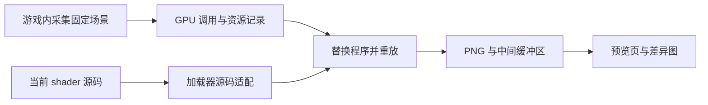

# 离线预览

更新日期：2026-10-10。适用目标：日常预览不运行 Minecraft，允许在准备阶段启动游戏并采集固定场景。

本机已搭建并验证 apitrace 管线。准备阶段使用独立存档副本和真实 OptiFine 渲染，日常阶段执行离线源码转换与 GPU 调用重放。当前使用本机 Minecraft 1.21.11、Forge 61.0.8、OptiFine HD U J9 和 Apple M3。早期采集使用 Forge 61.2.1；该组合存在界面和资源加载兼容问题，详情见[伴随光照](17-伴随光照.md)。

## 运行

当前场景和工具已经准备好。修改 `shaders/` 后，在仓库根目录运行：

```bash
python3 tools/preview.py render
```

输出保存在 `.preview/latest/`：`index.html` 是预览页，`overview.png` 是场景总览，三十九个场景各有当前图、基准图和差异图，`report.json` 记录耗时及像素变化。实际图片为 1920×1080；采集窗口设为 960×540，Retina 像素密度为 2。

只预览水面，或让脚本在保存源码后重新渲染：

```bash
python3 tools/preview.py render --scene water
python3 tools/preview.py watch --scene water
```

`--scene` 可以重复使用，支持 `daylight`、`sunset`、`night`、`water`、`underwater`、`clouds`、`fog`、`cloud_below`、`cloud_inside`、`cloud_above`、`cloud_motion`、`water_reflection`、`water_reflection_motion`、`water_cave_dark`、`water_cave_lit`、`water_cave_night`、`water_glass`、`local_shadow_dark`、`local_shadow_lit`、`local_light_night`、`vegetation`、`vegetation_motion`、`vegetation_roots`、`vegetation_shadows`。预览页使用本地图片，文件更新后刷新页面即可。编译或重放失败时页面明确显示失败，避免将上一次图片当作新结果。

在另一台匹配的 Mac 上准备工具和场景，或因管线结构变化重新采集：

```bash
python3 tools/preview.py setup
python3 tools/preview.py probe
python3 tools/preview.py capture --instance ~/minecraft/versions/1.21.11-Forge-OptiFine --world 新的世界
python3 tools/preview.py capture --refresh
python3 tools/preview.py verify
```

`capture` 会复制指定存档到 `.preview/game/saves/ShaderPreview/`，生成石柱、树叶、灯和水池，并自动切换相机、时间和截图。`--refresh` 先把已有采集目录保存在 `.preview/archive/`，然后重新准备。原始存档和游戏设置不会被写入。也可以通过 `--java-home` 指定 Java 安装目录。

`.preview/` 已加入 Git 忽略列表，其中包含存档副本、游戏资源、捕获记录、工具配置和生成图片。apitrace 源码与二进制保存在 `~/Library/Caches/SimpleShader/`。Python 图像依赖安装在 `.preview/venv/`。

## 验证

`python3 tools/preview.py verify` 执行实际 GPU 验证，结果保存到 `.preview/verification/verification.json`。本机结果如下：

| 检查 | 结果 |
| --- | --- |
| 小型 OpenGL 场景重放 | 与原始像素完全一致 |
| 离线源码转换 | 34 个入口与 OptiFine 导出程序的 GLSL token 一致 |
| 三十九个实际游戏场景 | 与游戏截图逐像素一致 |
| 修改 `final.fsh` 的颜色输出 | 改变 2,073,600 个像素 |
| 修改水面顶点波幅 | 改变 288,305 个像素 |
| 云层可见性与半透明 | 关闭、0.65、0.95 三档不透明度的 GPU 输出对比通过 |
| 引入未声明变量 | 编译失败被明确拒绝 |
| 修改阴影分辨率 | 被配置检查拒绝，要求重新采集 |

三十九组基准渲染整批约 50–80 秒。包含源码替换、记录写入和图片比较的单场景修改测试约 20–105 秒；耗时会随磁盘缓存、场景及后台负载变化。

云镜头现已显示无贴图的立体方块云。随机骨架生成团簇、狭长、弯折和分叉轮廓，云团整体随风移动；顶面、底面与竖直侧面在云层内部也可见。默认厚度为 16 方块，半透明合成与天空色调变化在 composite 中完成。详情见 [云层](11-云层.md)。

工具包含三项本地修复：用 dyld interposition 捕获共享缓存中的 OpenGL；修正 Cocoa 重放行为并串行执行调用；让 apitrace 的 Python 序列化保留 UTF-8 源码。着色器替换后会重新读取 GPU 记录，检查替换是否真正生效。[上游 macOS 问题](https://github.com/apitrace/apitrace/issues/826)、[序列化源码](https://github.com/apitrace/apitrace/blob/master/cli/pickle.hpp)

## 结论

可采用 GPU 调用捕获与重放：先从实际 Minecraft 和光影加载器中记录固定场景的渲染调用、资源及状态，后续替换着色器并重新执行这些调用，直接导出图片。这样能够保留采集场景的实际几何、贴图和渲染状态，适合观察固定管线内的光照、阴影、水波、雾和后处理修改。

本次检索未找到一个成熟项目，能够在 Apple Silicon 上直接读取任意 OptiFine/Iris 光影包，并在完全独立于游戏的环境里完整复现它的渲染行为。已有工具提供捕获、重放和着色器替换能力，仍需实现针对本项目和指定加载器的适配层。

本机采用已验证的 apitrace。Windows/Linux 测试机可以另行评估 RenderDoc，并建立自己的基准。RenderDoc 官方支持列表没有 macOS，OpenGL 支持限定为 Core Profile，不能仅根据光影文件的 GLSL 版本判断兼容性。[RenderDoc 项目说明](https://github.com/baldurk/renderdoc)

## 当前项目

仓库使用 OptiFine/Iris 光影包格式，入口为 GLSL 120，包含 `shadow`、`gbuffers_*`、`composite`、`composite1` 和 `final`。几何阶段直接计算光照和雾，后处理完成泛光和色调映射。当前没有启用 TAA 等依赖多帧历史的效果。

本次采集的环境为 Minecraft 1.21.11、Forge 61.2.1、OptiFine 1.21.11 HD U J9、Apple M3、Apple OpenGL 4.1。采集使用已安装的依赖、资产和原始存档副本，客户端在完成三十九个场景后自动退出。

离线方案需要覆盖以下依赖：

| 依赖 | 本项目中的用途 |
| --- | --- |
| 实际顶点数据和变换 | 地形、云、实体和水面的形状、顶点色、法线及纹理坐标 |
| 地形图集和光照贴图 | 方块外观、天空光及方块光输入 |
| 玩家与阴影矩阵 | 坐标还原、阴影投影和水波的世界坐标 |
| 时间与环境 uniform | 日夜光照、水波相位、雨强、水下雾和抖动 |
| 缓冲区及绘制状态 | 多目标输出、深度测试、透明混合和后处理输入 |

例如，`gbuffers_water.vsh` 根据世界坐标与 `frameTimeCounter` 计算顶点波浪；天空中的程序化云依赖相机坐标、视线反投影、时间和日夜光照输入。只导入几张 G-buffer 图片，无法覆盖完整的顶点变换与天空绘制行为。

已有 `tools/check_glsl.py` 适合检查 GLSL 语法和类型，但它没有创建真实渲染上下文，也不执行图像渲染。它的预处理不能直接充当光影加载器的完整替代。

## 项目筛选

| 项目 | 可复用能力 | 与需求的关系 |
| --- | --- | --- |
| RenderDoc | 捕获 GPU 帧、替换场景着色器、检查中间缓冲区、脚本化重放 | Windows/Linux 候选；需要适配加载器源码处理和程序映射 |
| apitrace | 记录和重放 OpenGL 调用、编辑 trace、命令行导图 | 本机已采用，完成当前实例的捕获和重放验证 |
| SHADERed | 多通道渲染、几何与纹理输入、自动重编译、图像序列导出 | 可作为独立实验环境；需要自行重建 Minecraft 输入和管线 |
| Gloamlight 的预览脚本 | 用光影包自身程序渲染程序生成的方块场景 | 可参考实现结构；输入、场景及加载器行为均为近似 |
| Chunky | 从 Minecraft 世界生成路径追踪图片 | 使用独立渲染器，不能作为当前光影包效果的等价验证 |
| ReplayMod / Minema | 游戏内回放、固定时间采样或导出图像序列 | 仍需运行客户端；不满足已确认的日常运行约束 |
| Fabric Client GameTest | 等待区块渲染、自动截图、图像比较、CI 执行 | 适合自动客户端验证；不是独立离线渲染，也不能直接用于当前 Forge 实例 |

RenderDoc 的场景 shader 编辑会影响使用该 shader 的绘制调用，OpenGL 的原生 shader 格式是 GLSL。因此它具备重放修改后渲染结果的基础能力。[着色器编辑文档](https://github.com/baldurk/renderdoc/blob/v1.x/docs/how/how_edit_shader.rst)

apitrace 官方文档包含 macOS 捕获、调用重放、图像导出和图像差异报告。其 `sed` 实现支持从文件读取替换字符串，并按调用编号限制替换范围；重放程序提供 `--headless`、指定调用导图和多渲染目标导出选项。本项目在这些能力之上完成了本机适配和实际 GPU 验证。[使用文档](https://github.com/apitrace/apitrace/blob/master/docs/USAGE.markdown)、[替换实现](https://github.com/apitrace/apitrace/blob/master/cli/cli_sed.cpp)、[重放选项](https://github.com/apitrace/apitrace/blob/master/retrace/retrace_main.cpp)

SHADERed 支持外部编辑器修改后自动重编译、渲染纹理、渲染状态、模型输入和图像序列导出。官方说明未提供开箱即用的 OptiFine/Iris 管线导入能力，使用它仍需编写适配。[项目说明](https://github.com/dfranx/SHADERed)

Gloamlight 的 `tools/render_preview.py` 使用 GLFW、PyOpenGL、NumPy 和 Pillow，执行该包的多个渲染程序。作者明确说明它使用平色方块和近似的矩阵、uniform，且该包当时尚未在游戏内验证。它适合作为工程参考，不适合作为画面一致性的依据。[预览代码](https://github.com/QuarkOS/gloamlight-shaders/blob/main/tools/render_preview.py)、[项目限制](https://github.com/QuarkOS/gloamlight-shaders#development)

Chunky 官方将其定义为 Minecraft 世界的路径追踪工具。Minema 的说明则描述了对游戏引擎和 OptiFine 时间的同步；它所说的离线渲染仍在游戏内部进行。[Chunky](https://github.com/chunky-dev/chunky)、[Minema](https://github.com/daipenger/minema)、[ReplayMod](https://github.com/ReplayMod/ReplayMod)

Fabric 官方给出了客户端测试、截图和 CI 流程，包括 `runClientGameTest` 和 Linux XVFB。此方案仍启动真正的 Minecraft 客户端；文档当前版本为 26.2，针对 1.21.11 使用时需要锁定匹配的 Loom、Fabric API 和加载器版本。[测试文档](https://docs.fabricmc.net/develop/automatic-testing)

## 固定管线



准备阶段使用实际目标实例和独立测试世界，锁定版本、资源包、分辨率、视距、FOV 和光影选项，采集各场景。日常阶段只运行源码适配与 GPU 重放工具，不运行 Minecraft 客户端、服务端或回放模组。

当前代码和生成数据按以下结构组织：

```text
tools/preview.py         setup、capture、render、watch、verify、verify-water、verify-materials、verify-wind、verify-underwater 入口
tools/preview/
  runtime.py            固定版本构建、macOS 修复和 GPU 探针
  minecraft.py          独立实例准备和启动
  CaptureScenes.java    游戏内场景生成、相机切换和基准采集
  source.py             include、宏与加载器转换校验
  java/                 OptiFine 离线转换入口及宿主桥接
  replay.py             GPU 程序映射、替换、导图和预览页
  water_checks.py       水体局部光照、倒影、波动与粗糙度验证
  material_checks.py    透射参数、浑浊度与局部光照连续性验证
  wind_checks.py        植被风摆、根部、接缝、法线与同步阴影验证
  wind_probe.m          OpenGL 顶点变换反馈探针
  underwater_checks.py  水下深度、折射、模糊、局部发光及天空缺口验证
.preview/
  game/                 独立游戏目录与存档副本
  captures/             实际 GPU 调用记录和日志
  manifest.json         程序映射、帧位置和配置校验信息
  latest/               当前预览、差异图和元数据
  verification/         实际 GPU 修改测试的结果
```

调用记录不能只保留几个绘制命令。裁剪记录时必须保留上下文、程序创建、纹理与缓冲区上传、FBO 配置和目标帧依赖的资源。必要时保留从初始化到目标帧的完整短记录，确认重放正确后再压缩。

当前输出最终图、基准图、差异图、编译和链接日志、程序替换数量及耗时。阴影图/G-buffer 的独立导出可继续扩展，也可以使用光影包已有的 `DEBUG_VIEW` 观察中间信息。差异图用于定位变化，不能把任何画面变化都判定为错误。捕获资源及游戏资产留在本地，不纳入公开仓库。

## 源码适配

最大的实现工作在原始源码与捕获程序之间。

光影加载器会展开 `#include`、注入平台宏和选项，并可能重写顶点输入、内置变量、片元输出等。Iris 官方明确说明，光影包源码并不是 GPU 最终执行的源码，兼容性修补后的程序可在调试模式下导出到 `patched_shaders`。[Iris Patcher](https://shaders.properties/current/reference/miscellaneous/patcher/)

直接把 `shaders/gbuffers_terrain.vsh` 填入捕获记录通常不够。适配层针对锁定的 OptiFine 生成程序，并保留输入、输出和资源绑定。当前转换已经与该实例导出的源码比较；Iris 的转换方式不能直接作为 OptiFine 的实现依据。

当前实现已处理以下事项：

1. 映射捕获中本项目的 34 个入口，重新转换整个光影包，以覆盖公共库修改。
2. 复用已安装 OptiFine 的 `ShadersCompatibility`，仅用宿主桥接避免启动完整游戏；转换结果必须先与游戏导出代码比较。
3. 保留 captured 平台宏，复现 include 和光照贴图纹理单元转换。
4. 检查 attribute、uniform、sampler 和输出声明；接口变化要求重新采集。
5. 当前 OptiFine 使用单字符串及空长度指针。对不支持的分段/长度形式拒绝自动映射，并检查替换后的完整源码。
6. 编译、链接、配置和替换失败均标记为失败。允许的 GL 错误仅限原始捕获中用于探测最大纹理尺寸的已知代理纹理调用。

如果为了降低适配成本改用 Iris，应单独建立 Iris 的采集与基准。它可以验证在 Iris 中的实际表现，但不能据此宣称与目前 OptiFine 实例完全一致。

## 测试场景

建议使用同一个小型测试世界的三十九组固定镜头。水面和云额外保存少量时间采样，检查动画与高光变化。

| 场景 | 内容与观察点 |
| --- | --- |
| 正午光照 | 草地、不同朝向的石柱、明暗交界；检查漫反射、天空光和色彩 |
| 低角阴影 | 日落石柱、树叶、阶梯、贴地物体；检查 PCF、自阴影和阴影偏移 |
| 夜间照明 | 火把、暗室、洞口；检查方块光、曝光与泛光 |
| 水面近景 | 浅水池、深水、岸边、斜视角；检查顶点波浪、逐像素法线、高光与混合 |
| 水下视角 | 从水下观察岸边和远景；检查水下雾与环境状态 |
| 天空云层 | 地平线、日月、头顶及远处云；检查云网格、顶点色与混合 |
| 远景雾层 | 近、中、远三排地形；检查雾距离、颜色及视距衔接 |
| 云层边界 | 云下、云内、云上三个镜头；检查立体边界与穿行 |
| 云层运动 | 同一视角的后续时间采样 |
| 室外倒影 | 彩色立柱及连续两帧水波；检查反射扭曲、模糊与运动 |
| 洞穴水池 | 封闭暗水池、火把水池、同位置夜间水池；检查日照隔离与局部光照 |
| 玻璃遮挡 | 水池前的染色玻璃；检查透明材质识别 |

当前记录的实际分辨率为 1920×1080，阴影分辨率遵循光影配置。改变采集尺寸需要重新采集，不能只修改导图尺寸就认为与游戏输入一致。

相机、时间、天气和噪声输入需要固定。`frameTimeCounter` 与 `frameCounter` 不会因仅固定世界时间而自动一致，必须记录或显式控制。原始截图与重放基准应来自同一采集帧，避免将水波相位或抖动差异误认为重放错误。

## 使用边界

| 修改类型 | 是否可以沿用采集记录 |
| --- | --- |
| 光照、阴影采样、水波公式、雾函数、泛光和色调映射 | 通常可以；需保持程序接口和运行配置兼容 |
| 普通 shader 宏与数值 | 通常可以；适配层需重新生成所有相关程序 |
| `shadowMapResolution`、`shadowDistance`、`sunPathRotation` 等加载器读取的配置 | 不宜直接沿用；涉及资源尺寸、矩阵或绘制范围，应重新采集或实现对应宿主配置更新 |
| `colortex*Format`、`DRAWBUFFERS`、混合状态、新增通道或纹理 | 需要重建运行配置并重新采集，或扩展重放执行器 |
| 方块模型、资源包、区块范围、CPU 剔除规则 | 需要更新场景数据和采集记录 |
| TAA、自动曝光历史、时域降噪 | 需要连续帧及正确历史传递，单帧捕获不足以验证新算法的收敛 |

即使顶点着色器能够改变水面形状，重放仍只包含采集时提交的几何；新的大幅位移不能自动让被 CPU 剔除的物体出现在记录里。

当前项目没有启用时域累积，适合从固定帧开始。以后增加时域效果时，需要连续执行修改后的程序来生成历史，分别检查预热、稳态和运动。多个独立捕获帧里的旧历史不能自动组成新 shader 的正确连续结果。

在同一机器、驱动、输入和运行配置下，可以用采集基准验证重放误差。跨平台或跨 GPU 不应承诺逐像素一致，也不能从另一台机器的结果推断 Apple 驱动上的全部兼容性问题。

## 后续扩展

当前已完成工具构建、场景采集、源码适配、批量导图、失败检查和源码监听。后续扩展应沿用相同的验收条件：

1. 云镜头已建立可见且半透明的基准；后续可以增加不同高度、天气和运动采样。
2. 云下、云内、云上与运动镜头，以及水面时间采样、暗洞穴、火把洞穴与玻璃镜头已加入；后续可增加实体场景。
3. 验证新效果既能更新实际 GPU 图片，也能在编译和配置错误时明确失败。
4. 新增时域效果时建立连续帧和历史传递，不能沿用单帧测试的结论。

验收条件为：游戏已退出；未修改源码的重放与采集基准误差可解释；修改当前源码后相关场景发生预期变化；日志证明替换成功；耗时满足开发需要。当前已经验证最终输出与水面顶点修改，其他新增效果需分别建立视觉验证。

如果 macOS 的捕获注入或源码适配不可用，可以在 Windows/Linux 上锁定测试环境并验证 RenderDoc/apitrace。若要求保留当前 Apple/OptiFine 的全部行为，则该替代环境只能作为额外验证，不能替代本机基准。

水体专用场景和 GPU 对照检查见 [水体](12-水体.md)。新增附件、材质 ID 映射或渲染阶段后必须重新采集；预览器同时检查 `block.properties` 与缓冲清除颜色。

局部光照的三个镜头与连续采样说明见 [局部光照](13-局部光照.md)。

植被四个镜头与风摆验证见 [植被](14-植被.md)。增加顶点属性后已重新采集，日常修改位移函数仍可直接离线重放。

水下镜头与八个天空方向镜头见 [水下](15-水下.md)。源场景数量现为 47，新增背景清除色和顶点接口时已重新采集。

## 光照对照

床、石柱阴影与夜云的固定镜头见 [局部光照](13-局部光照.md)。当前 47 个镜头包括床的昼夜和火把照明对照、同一石柱地面的日月阴影填充对照；新增设置已通过加载器实际识别检查。

```bash
python3 tools/preview.py verify-lighting
```
